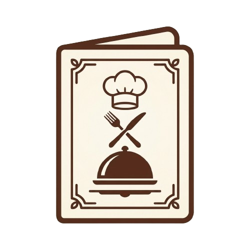

<p align="center">
  
</p>

<h1 align="center">MenuLab</h1>

<p align="center">
  Jogo educativo sobre <b>planejamento de cardápios</b>, desenvolvido em Unity como Trabalho de Conclusão de Curso (TCC).
</p>

<p align="center">
  
  
  
  
  
</p>

---

## Sobre o jogo

No **MenuLab** o jogador assume o papel de um **nutricionista** responsável por montar cardápios para diferentes instituições e públicos. A cada fase, ele recebe um *briefing* com o local, o público atendido e a refeição a ser planejada, e precisa **arrastar alimentos da despensa** para os espaços do cardápio (prato principal, acompanhamento, guarnição, salada, sobremesa, bebida etc.).

Ao finalizar, o jogo avalia o cardápio montado e apresenta um **feedback detalhado** item a item, explicando o que foi uma boa escolha, o que merece atenção e o que é inadequado — além de uma nota em três critérios.

## Fases

| Fase | Tema | Local | Público | Refeição |
|:---:|---|---|---|---|
| 1 | Café da manhã na creche | Creche municipal | Crianças de 4 a 5 anos | Café da manhã |
| 2 | Almoço hospitalar | Hospital | Adultos com intolerância à lactose | Almoço |
| 3 | Almoço no refeitório da empresa | Refeitório de uma empresa | Trabalhadores adultos | Almoço |
| 4 | Jantar na instituição | Casa de repouso | Pessoas com 65 anos ou mais | Jantar |
| 5 | **Desafio final** | Refeitório de uma empresa | Trabalhadores adultos | Café da manhã, almoço e jantar |

- As fases são **desbloqueadas progressivamente**: é preciso obter **nota final ≥ 7** para liberar a seguinte.
- Na **Fase 5** o jogador monta o cardápio de um dia inteiro **sem o livro de apoio**, aplicando tudo o que aprendeu.

## Funcionalidades

- 🍽️ **Montagem de cardápio por arrastar e soltar** (*drag & drop*) a partir de uma despensa com 80 alimentos e preparações.
- 📖 **Livro de apoio (HelpBook)** com capítulos e índice alfabético, consultável durante as fases 1 a 4.
- 📋 **Briefing** de cada fase com contexto, público e objetivo.
- 🧮 **Avaliação automática** do cardápio com feedback textual explicativo.
- 🗺️ **Mapa de fases** com progressão e desbloqueio.
- 💾 **Progresso salvo** localmente (PlayerPrefs), com opção de iniciar um novo jogo.
- 🔊 **Trilha sonora e efeitos sonoros** (cliques, soltar alimento, feedback de nota boa/ruim).

## Sistema de avaliação

Cada alimento do jogo é catalogado com diversos atributos (`CategorizacaoAlimento`):

- **Função** no cardápio (principal, acompanhamento, guarnição, salada, sobremesa, bebida, complemento)
- **Refeição** em que é adequado (café da manhã, almoço, jantar)
- **Nutrientes**, **grupo alimentar**
- **Características sensoriais e de preparo**: cor, sabor, textura, estado e método de preparo

O `MenuFeedbackEvaluator` analisa o cardápio na seguinte ordem:

1. **Refeição** — o alimento é apropriado para aquela refeição?
2. **Função** — ele está no espaço correto do cardápio?
3. **Regras específicas da fase** — ex.: lactose na Fase 2, adequação ao público infantil ou idoso
4. **Nutrientes** do cardápio como um todo
5. **Variedade** — repetição de cores, sabores, texturas e métodos de preparo
6. **Grupos alimentares**

A nota é composta por três critérios, cada um iniciando em **10** e sofrendo descontos conforme os problemas encontrados:

| Critério | Descrição |
|---|---|
| **Adequação nutricional** | Composição de nutrientes e funções dos alimentos |
| **Adequação ao público** | Respeito às necessidades e restrições do público da fase |
| **Variedade** | Combinação de cores, sabores, texturas e métodos de preparo |

**Nota final** = média dos três critérios. Na Fase 5, a nota é a média das três refeições.

## Tecnologias

- **Unity 6** (`6000.3.19f1`) com **Universal Render Pipeline (2D)**
- **C#**
- **uGUI** + **TextMesh Pro** para a interface
- **Input System**
- [Febucci Custom Hierarchy](https://github.com/febucci/unitypackage-custom-hierarchy) (organização da hierarquia no editor)
- Unity Recorder (gravação de vídeos de demonstração)

## Como executar

### Pelo editor

1. Instale o **Unity Hub** e o editor **Unity 6000.3.19f1**.
2. Clone o repositório:
   ```bash
   git clone https://github.com/Nick4nick/TCC.git
   ```
3. No Unity Hub, clique em **Add → Add project from disk** e selecione a pasta clonada.
4. Abra a cena `Assets/Scenes/MenuLab.unity` e pressione **Play**.

### Gerando uma build

1. No editor, acesse **File → Build Profiles** (ou *Build Settings*).
2. Selecione a plataforma **Windows** e confirme que a cena `MenuLab` está na lista.
3. Clique em **Build** e execute o `MenuLab.exe` gerado.

> A cada build, o script `Assets/Editor/BuildIdGenerator.cs` gera um ID único. Ao abrir o jogo, se o ID salvo for diferente, o progresso antigo é descartado — assim uma build nova nunca abre com o save de um teste anterior.

## Estrutura do projeto

```
Assets/
├── Editor/
│   └── BuildIdGenerator.cs        # Gera ID único por build (reset de save)
├── MenuLab/
│   ├── fonts/                     # Bree Serif, Cormorant Garamond, Dekko, Inter
│   ├── imgs/                      # Telas, ícones, alimentos, mapa de fases, popups
│   ├── prefabs/
│   ├── sound/                     # Músicas e efeitos sonoros
│   └── script/
│       ├── GameConfig.cs          # Fluxo do jogo: menus, fases, briefing, livro, feedback, save
│       ├── MenuManager.cs         # Gerencia o cardápio em montagem
│       ├── MenuFeedbackEvaluator.cs  # Regras de avaliação e textos de feedback
│       ├── MenuScoreResult.cs     # Nota nos três critérios
│       ├── CategorizacaoAlimento.cs  # Atributos de cada alimento
│       ├── AlimentoEnums.cs       # Enums: alimentos, função, refeição, nutrientes, cor, sabor...
│       ├── FlagsMapping.cs        # Conversões e comparações entre flags
│       ├── EnumDisplayHelper.cs   # Nomes de exibição dos enums
│       ├── FoodDragHandler.cs     # Arrastar alimentos
│       ├── FoodDropZone.cs        # Espaços do cardápio que recebem alimentos
│       ├── DropZoneFoodDrag.cs    # Re-arrastar alimentos já posicionados
│       ├── LevelSelectedConfig.cs # Configuração da fase selecionada
│       ├── Menus.cs               # Referências das telas
│       ├── PopUpManager.cs        # Popups de confirmação
│       ├── ScrollViewUtils.cs     # Utilitários de scroll
│       └── SoundManager.cs        # Música de fundo e efeitos sonoros
├── Scenes/
│   └── MenuLab.unity              # Cena principal do jogo
└── Resources/
```

## Autor

**Nick Kuerten** — [@Nick4nick](https://github.com/Nick4nick)

Projeto desenvolvido como Trabalho de Conclusão de Curso.

## Créditos

- Fontes: [Bree Serif](https://fonts.google.com/specimen/Bree+Serif), [Cormorant Garamond](https://fonts.google.com/specimen/Cormorant+Garamond), [Dekko](https://fonts.google.com/specimen/Dekko) e [Inter](https://fonts.google.com/specimen/Inter), sob a licença SIL Open Font License (OFL).
